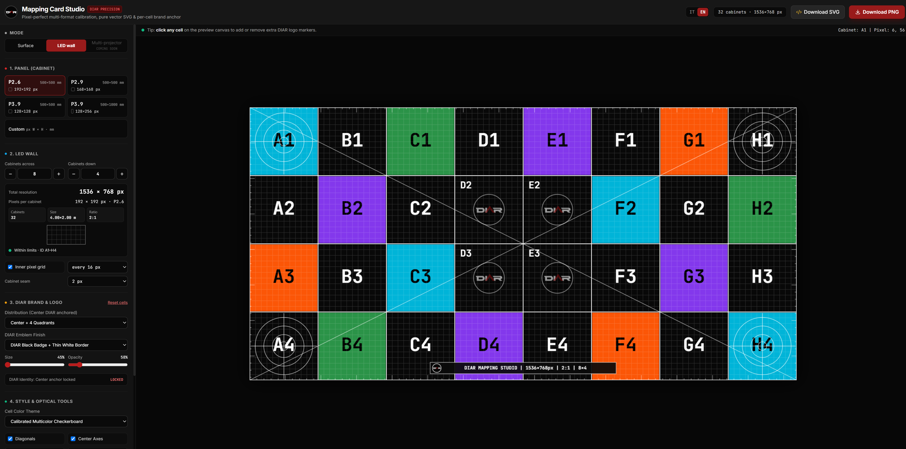
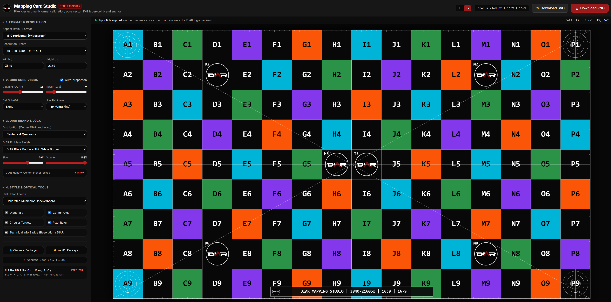
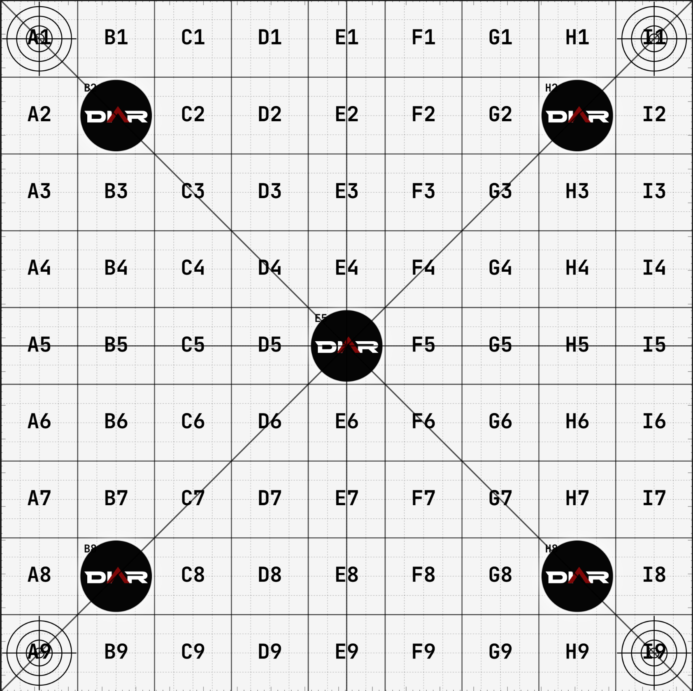

# DIAR — Mapping Card Studio

Pixel-perfect alphanumeric calibration grid and vector test card generator for projection mapping, LED walls, and live event production.

Live Web Application: https://diarsrl.github.io/DIAR-Mapping-Card-Studio/
## Preview & Examples

| Example 01 | Example 02 |
| :---: | :---: |
|  |  |
## Overview

DIAR Mapping Card Studio generates mathematically accurate calibration patterns directly in the browser. It is designed for AV technicians, media server operators, and visual artists working with Resolume Arena, MadMapper, TouchDesigner, Disguise, or Millumin.

## Specifications

- Formats and Resolutions: Presets for 16:9 horizontal, 16:9 vertical (portrait), 1:1 square, 4:3, 16:10 WUXGA, and custom pixel dimensions up to 8192x8192 px.
- Grid System: Unambiguous alphanumeric cell coordinates (A1 through AF32), optional 2x2 and 4x4 dashed sub-grids, optical diagonals, center axes, concentric corner targets, and a 1px perimeter pixel ruler.
- Interactive Markers: Click any cell on the preview canvas to add or remove extra DIAR alignment markers while keeping the center reference locked.
- Export Formats: Direct client-side export in high-resolution PNG and scalable pure vector SVG.
- Localization: Automatic browser language detection (English and Italian) with manual switch.
- Offline Packages: Installable as a Progressive Web App (PWA) or downloadable as standalone Windows and macOS offline packages.

## Usage

1. Open the web application in a modern browser.
2. Select the target aspect ratio and output resolution.
3. Configure grid subdivision, optical overlays, and background color mode (calibrated multicolor, IRE grayscale, pure black, or pure white).
4. Export the calibration card as SVG or PNG, or download the offline desktop package for show-site use without internet access.

## License and Attribution

Copyright (c) 2026 DIAR S.r.l. — Rome, Italy. All Rights Reserved.
VAT / Tax Code (P.IVA / C.F.): 18748551001 — REA: RM - 1803784

This software is provided free of charge for personal and commercial AV and projection mapping use. Redistribution is permitted provided that the DIAR S.r.l. brand identity, circular emblem, and legal attribution remain intact.

The software is provided "as is", without warranty of any kind, express or implied.
